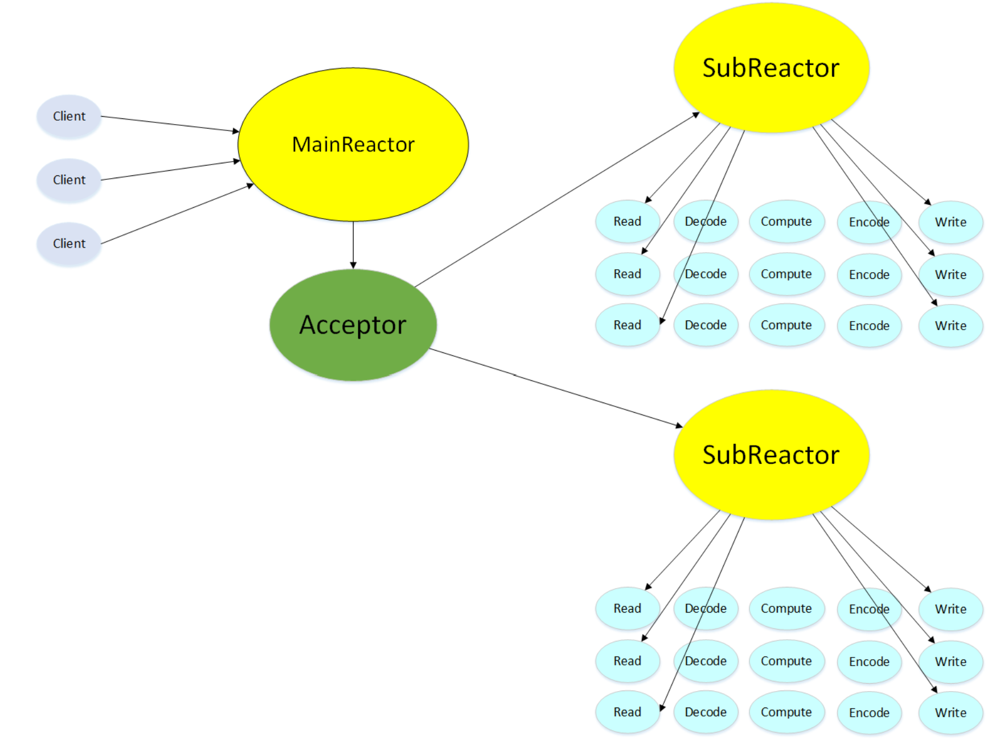

# C++ High Performance WebServer

基于 Reactor 多线程模型的轻量级 HTTP 服务器.

## 项目简介
使用 Epoll + 事件驱动 + 主从 Reactor 模型实现的 Web 服务器。
- **主线程（Main Reactor）**：负责监听 socket，接受新 TCP 连接
- **子线程池（Sub Reactor）**：处理已建立连接的 IO 读写、HTTP 报文解析
- 支持 ET 边缘触发，使用 `eventfd` 跨线程唤醒事件循环
- 支持 HTTP/1.1 长连接，定时器管理超时连接，自动关闭空闲连接
- 采用 RAII + 智能指针管理连接资源，避免内存泄漏

## 项目架构图


## 技术栈
- C++11
- Linux Epoll IO 多路复用
- Reactor 事件驱动模型
- 线程池 + EventLoop 事件循环
- HTTP/1.1 报文解析状态机
- eventfd 线程间通信
- 智能指针 RAII 管理资源

## 编译方式
环境：Ubuntu Linux，gcc/g++ (支持 C++11)
```bash
# 克隆代码
git clone https://github.com/bubibuki/myWebServer.git
cd myWebServer

# 编译
mkdir build
cd build
cmake ..
make
运行服务
bash
cd build
# -t：线程数量  -p：监听端口
./WebServer -t 4 -p 8080
压力测试
测试工具：WebBench
测试环境：Ubuntu Linux 虚拟机，4 个 Reactor 线程

短连接高并发测试（500并发，持续 120 秒）：
压测结果截图：总计完成 7,876,539 次请求，0 失败，QPS 约为 6.5 万。
https://./doc/webbench_120s.png

CPU 负载与内存占用：
多线程高并发下，4 个 EventLoop 线程被充分唤醒，CPU 利用率达 300%+，内存恒定在 40MB 左右，无内存泄漏。
https://./doc/top_stress.png

长连接验证 (Keep-Alive)：
由于本地 VMware 虚拟机网络栈限制，ab 压测工具存在兼容性问题。但通过 curl -v 连续发送两次请求，成功验证底层复用了 TCP 连接，证明长连接机制完全生效。
https://./doc/keepalive.png

核心文件说明
EventLoop：事件循环核心，epoll 封装、任务队列、eventfd 唤醒

Channel：封装 fd 和对应的读写回调

Epoll：epoll 的封装类

EventLoopThread / EventLoopThreadPool：Reactor 线程池

Server：服务器主体，listen socket，接受新连接

HttpData：HTTP 报文解析状态机，处理请求报文

项目亮点
主从 Reactor 分离：连接接受和 IO 处理分到不同线程，并发性能更好，充分利用多核 CPU。

无锁设计：使用 eventfd 实现跨线程任务投递，避免锁竞争。

资源管理：RAII + shared_ptr 管理连接生命周期，彻底避免内存泄漏。

超时管理：定时器自动清理长时间无数据的空闲连接，防止文件描述符（FD）泄露。

代码模块化：结构清晰，易于阅读和二次扩展。

遇到的问题与解决
SIGPIPE 信号导致程序崩溃：全局忽略或捕获 SIGPIPE 信号，避免客户端异常断开时服务崩溃。

跨线程回调安全：使用 EventLoop::assertInLoopThread 检查线程归属，确保线程安全。

长连接保活与超时：实现定时器轮盘/小根堆管理超时连接，长连接空闲超过设定时间自动清理。

压测工具网络栈限制排查：在虚拟机压测时，ab 因半连接队列溢出报错。通过调整系统参数并用 webbench 验证，最终实现了单机高并发下 0 失败，同时运用 curl 验证了长连接复用机制。
